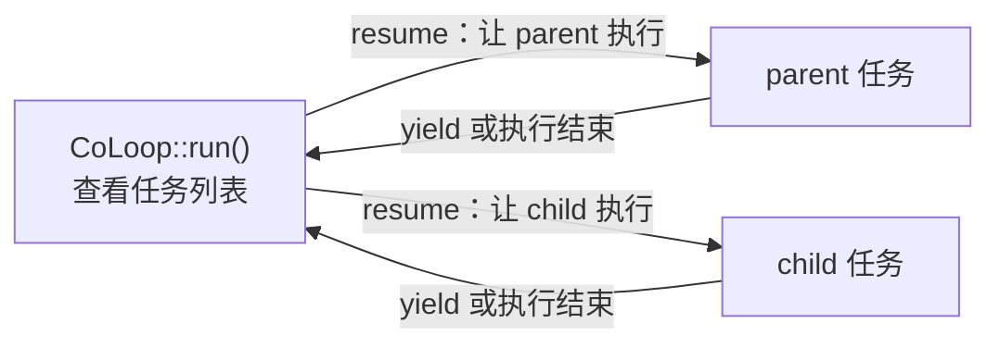
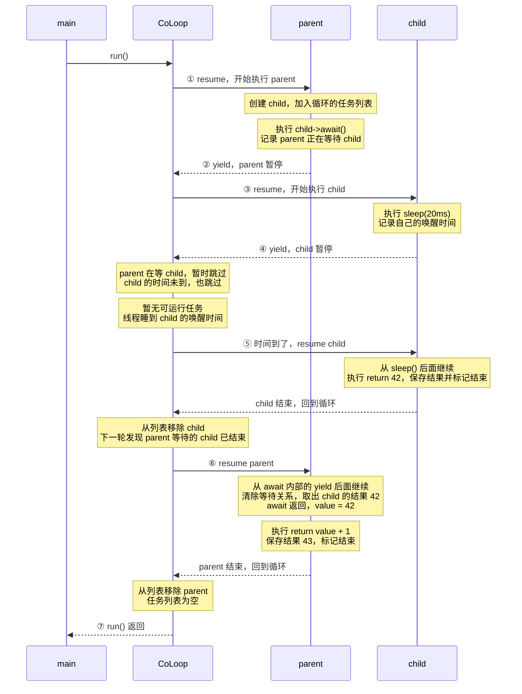

# 协程循环与任务

包含 `co_loop.hpp`，通过当前线程的单例创建任务：

```cpp
using namespace std::chrono_literals;
using namespace std::string_literals;

auto& loop = yq::CoLoop::instance();
auto parent = loop.spawn([] {
    auto child = yq::CoLoop::instance().spawn([] {
        yq::co::sleep(20ms);
        return 42;
    });

    int value = child->await(); // 暂停 parent，让循环执行其他任务。
    return "answer: "s + std::to_string(value);
});
loop.spawn([] {
    // parent 和 child 等待时，执行一些其他工作。
    yq::co::sleep(0ms);
});

loop.run();
std::cout << parent->result(); // answer: 42
```

- `spawn(f, args...)` 保存函数和参数，不立即执行；返回 `shared_ptr<CoTask<R>>`。引用返回按值保存，参数可以用 `std::ref`。
- `CoTask<R>` 内部持有 `Coroutine<R>`。循环通过公共基类调度，取结果时不需要类型转换。
- `result()` 只允许任务结束后调用，按值取出最终结果并清空。支持 `void` 和只能移动的值。
- `await()` 在循环任务内等待未完成的任务。已经结束的任务也可以在根上下文直接 `await()`；尚未结束时，根上下文应该先 `run()`。
- `await()` 同样消费结果；一个结果只能由一个调用者取走。自我等待和循环等待会抛出 `CoroutineException`。
- `cancel()` 取消尚未开始或暂停中的任务，展开暂停任务的局部对象；重复取消已经结束的任务直接返回。运行中或正在取消的任务不能取消。取消任务没有可取的结果。
- `co::sleep(delay)` 可以在普通函数中调用，不需要捕获协程。`sleep(0ms)` 让出一次执行权；全部可运行任务都在睡眠时，循环线程才睡眠。
- 直接 `co::yield()` 或 `co::yield(value)` 也会让出执行权，但循环不收集每次暂停值，只保留任务最终结果。
- `run()` 在根上下文调用，执行到任务列表为空；同一个循环可以重复运行。任务内可以继续 `spawn()`。
- 一个任务抛异常时，`run()` 取消剩余任务并回抛异常；失败任务第一次 `result()` 仍会抛出原异常，该次调用也会消费结果。等待者也会被取消，不能依靠 `await()` 捕获该任务异常。

所有操作都在所属线程上执行。容器使用 `list`，支持任务执行期间追加新任务。手动恢复的内层协程可以使用全局 `yield`，但不能使用外层循环任务的 `sleep` 或等待未完成任务。

`main.cpp` 中每项测试单独写成函数，分为 `test_coroutine()` 和 `test_coroutine_loop()` 两组，输出执行顺序，不使用测试框架。

```powershell
cmake --build build/clang --target stack_demo_4
.\build\clang\stack\demo\4\stack_demo_4.exe
```

MSVC 使用 `build/cl`，可执行文件位于 `build/cl/stack/demo/4/Debug/stack_demo_4.exe`。


你的代码里，**所有任务都在同一个线程上运行。`CoLoop` 负责选任务，任务暂停或结束后，执行权回到 `CoLoop`。**

先看执行权怎么来回切换：



**任务执行到 `yield()` 时，会停在那个位置。下一次 `resume()`，就从停下的位置继续。**

我们用下面两个任务，走完一遍循环：

```cpp
using namespace std::chrono_literals;

auto& loop = yq::CoLoop::instance();

auto parent = loop.spawn([] {
    auto child = yq::CoLoop::instance().spawn([] {
        yq::co::sleep(20ms);
        return 42;
    });

    int value = child->await();
    return value + 1;
});

loop.run();
std::cout << parent->result(); // 43
```

`spawn()` 先把任务加入列表。调用 `run()` 后，才开始执行：



重点看图里的 **②到⑥**：parent 进入 `await()` 后，整个调用过程停住了；等 child 结束，parent 恢复，`await()` 才继续执行并返回 `42`。

在两个任务都暂停的时候，任务列表里的信息大致是：

```text
CoLoop 的任务列表
│
├── parent
│   ├── 状态：Suspended
│   └── m_waiting_on ──────────→ child
│
└── child
    ├── 状态：Suspended
    └── m_wake_at：20ms 后的时间点
```

因此，**同样是暂停，循环还需要知道“为什么暂停”**：

| 任务的情况 | 循环怎么处理 |
|---|---|
| 正在等另一个尚未结束的任务 | 跳过，继续检查其他任务 |
| 睡眠时间还没到 | 跳过，继续检查其他任务 |
| 等待已完成，且时间条件满足 | 调用 `resume()` |
| 已结束 | 从任务列表移除 |

你前面看的 `wait()`，对应图里的第②步：

```cpp
current->m_waiting_on = task;       // parent 记录：我在等 child
current->m_wake_at = 最小时间;       // 时间条件立即满足
current->base_coroutine().yield();  // parent 暂停，回到循环

// 到第⑥步，parent 被 resume 后，才继续执行这里。
current->m_waiting_on.reset();      // parent 清除等待关系
```

`m_current` 则随着执行权变化：

```text
循环选中 parent → m_current = parent
parent 交回执行权 → m_current = nullptr

循环选中 child  → m_current = child
child 交回执行权  → m_current = nullptr
```

所以 parent 调用 `child->await()` 时，循环能通过 `m_current` 找到 parent，并给 **parent 的 `m_waiting_on`** 填上 child。
